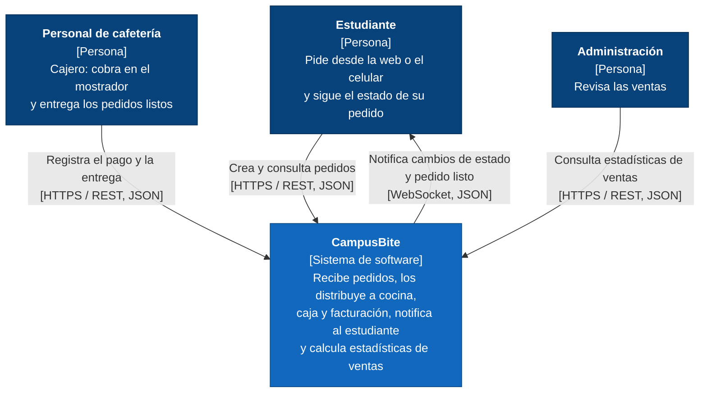

# Diagrama de contexto (C4 nivel 1)

- **Sistema:** CampusBite, pedidos de la cafetería del campus
- **Responsable del documento:** Integrante 1 (David)
- **Nivel C4:** 1, contexto del sistema. Muestra quién usa CampusBite y con qué se relaciona, sin entrar en cómo está construido por dentro. Los servicios y los mecanismos de comunicación se ven en `mapa-microservicios.md`.

## Problema

En las horas pico los estudiantes hacen fila para pedir, para pagar y para esperar su comida, y nunca saben cuándo va a estar listo su pedido. La cafetería necesita que cada pedido llegue a cocina, caja y facturación, y la administración quiere saber cuánto se vende.

## Diagrama

## Elementos

| Elemento | Tipo | Responsabilidad | Qué espera de CampusBite |
|---|---|---|---|
| Estudiante | Persona | Arma su pedido, lo envía y espera a que esté listo | Recibir enseguida un número de pedido, que el pedido no se duplique si su red falla y reintenta, y enterarse en tiempo real cuando esté listo |
| Personal de cafetería (cajero) | Persona | Cobra en el mostrador y entrega el pedido | Registrar el pago y la entrega una sola vez y no entregar un pedido que todavía no está listo o pagado |
| Administración | Persona | Supervisa cómo funciona la cafetería | Ver los pedidos recibidos, pagados y entregados, las ventas y los productos más vendidos |
| CampusBite | Sistema de software, el que construimos | Coordina el pedido de principio a fin | No aplica |

## Relaciones

| Desde | Hacia | Qué intercambian | Mecanismo | Tipo |
|---|---|---|---|---|
| Estudiante | CampusBite | Crear pedido, consultar estado, ver menú | REST sobre HTTP | Síncrona |
| CampusBite | Estudiante | Cambios de estado como en preparación, listo, pagado y entregado | WebSocket | Asíncrona, la inicia el servidor |
| Cajero | CampusBite | Registrar pago, marcar entregado | REST sobre HTTP | Síncrona |
| Administración | CampusBite | Consultar estadísticas | REST sobre HTTP | Síncrona |

## Alcance y supuestos

- **Sin sistemas externos.** El estudiante paga en efectivo o con tarjeta en el mostrador y el cajero solo registra el pago, así que no hay pasarela de pagos. La factura también la genera el propio sistema y no hay conexión con el SRI. Por eso el diagrama no tiene sistemas externos.
- **Sin autenticación.** El estudiante se identifica con su cédula o su código en el campo `idEstudiante`. En un sistema real haría falta el inicio de sesión de la universidad.
- **Datos en memoria.** La consigna lo permite. Si un servicio se reinicia pierde su estado, aunque los eventos siguen guardados en Kafka.
- **Kafka y gRPC no aparecen en este nivel.** Son mecanismos internos de CampusBite y se ven en el siguiente nivel, en `mapa-microservicios.md`.
