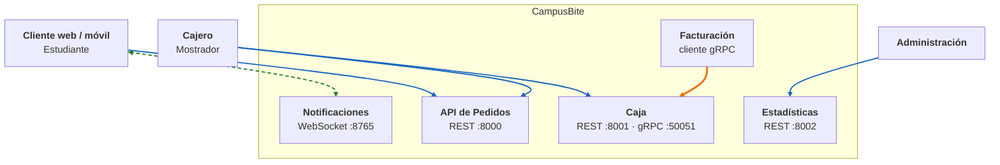
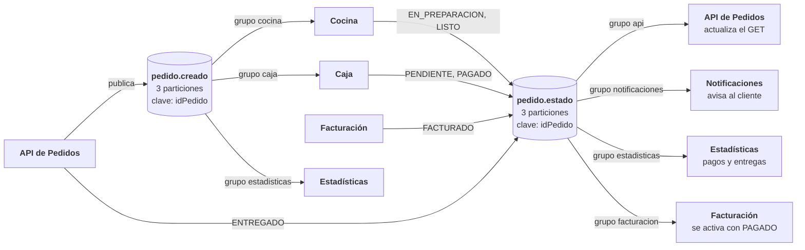
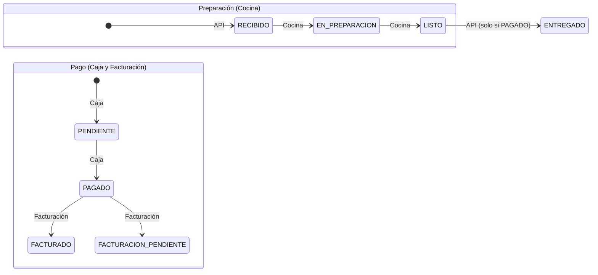

# Mapa de microservicios

- **Responsable del documento:** Integrante 1 (David)
- **Nivel:** el siguiente después del contexto C4 (`contexto-c4.md`). Muestra los servicios que forman CampusBite y el mecanismo de cada comunicación.
- **Contrato detallado** (endpoints, eventos, `.proto`, códigos): `docs/contratos.md`.

## Diagramas

El mapa se divide en dos vistas para que se lea con claridad. La primera muestra las comunicaciones directas (una petición con su respuesta, o una conexión abierta). La segunda muestra la comunicación por eventos a través de Kafka.

### Vista 1: comunicaciones directas (REST, gRPC y WebSocket)

| Línea | Mecanismo | Tipo | Comunicaciones |
|---|---|---|---|
| Azul continua | REST | Síncrona: quien llama espera la respuesta | Cliente → API (crear y consultar pedidos), cajero → API (entregar), cajero → Caja (registrar pago), administración → Estadísticas |
| Naranja gruesa | gRPC | Síncrona, con deadline de 2 s | Facturación → Caja (`ConfirmarPago`) |
| Verde punteada | WebSocket | Asíncrona: conexión abierta, el servidor envía los cambios cuando ocurren | Cliente ↔ Notificaciones |

### Vista 2: eventos por Kafka (asíncrono)

En la vista 2, la API, Estadísticas y Facturación aparecen dos veces para que el diagrama se lea de izquierda a derecha: a la izquierda como productores de eventos o consumidores de `pedido.creado`, y a la derecha como consumidores de `pedido.estado`. Facturación no consume `pedido.creado`: lee `pedido.estado`, ignora todo salvo `PAGO/PAGADO` y publica `FACTURADO` o `FACTURACION_PENDIENTE`. Un tercer topic, `pedido.dlq`, recibe los mensajes que un consumidor no pudo procesar después de sus reintentos.

## Servicios

| Servicio | Responsable | Puerto | Responsabilidad | Datos que le pertenecen (en memoria) | Estado del pedido que puede cambiar |
|---|---|---|---|---|---|
| API de Pedidos | Integrante 1 (David) | 8000 | Punto de entrada del estudiante y del cajero: valida, aplica idempotencia, calcula el total con el menú y publica `pedido.creado`. Mantiene la vista del estado de cada pedido | Menú, pedidos, claves de idempotencia | `RECIBIDO` (al crear) y `ENTREGADO` |
| Kafka | Integrante 2 (Caro) | 9092 | Bus de eventos: guarda y distribuye los eventos, con orden por `idPedido` | Topics `pedido.creado`, `pedido.estado` y `pedido.dlq` | — |
| Cocina | Integrante 2 (Caro) | — | Prepara el pedido sin esperar el pago | Pasos de preparación en curso | `EN_PREPARACION` y `LISTO` |
| Estadísticas | Integrante 2 (Caro) | 8002 | Calcula ventas, pedidos pagados y entregados, y productos más vendidos | Contadores y totales | — (solo lee) |
| Caja | Integrante 3 (Dome) | 8001 (REST) y 50051 (gRPC) | Registra el cobro pendiente al llegar el pedido, recibe el pago del cajero y responde `ConfirmarPago` | Cobros y confirmaciones | Pago: `PENDIENTE` y `PAGADO` |
| Facturación | Integrante 3 (Dome) | — | Al leer `PAGO/PAGADO`, confirma el pago con Caja por gRPC y emite una sola factura por pedido | Facturas emitidas | Facturación: `FACTURADO` y `FACTURACION_PENDIENTE` |
| Notificaciones | Integrante 4 (Cinthy) | 8765 | Mantiene las conexiones de los clientes y les reenvía los eventos de su pedido | Conexiones abiertas por `idPedido` | — (solo reenvía) |

Cada estado tiene **un solo dueño**. Ningún servicio modifica datos de otro: solo publica eventos o llama a su interfaz. Eso evita conflictos y permite saber siempre quién causó cada cambio, porque el evento lleva `origen`.

## Comunicaciones

| # | Origen → destino | Mecanismo | Tipo | Contrato | Por qué este mecanismo | Si el destino falla |
|---|---|---|---|---|---|---|
| 1 | Cliente → API | REST | Síncrona | `POST /pedidos`, `GET /pedidos/{id}`, `GET /menu` | El estudiante necesita su `idPedido` de inmediato; funciona en cualquier navegador (ADR-001) | El cliente reintenta con la misma `Idempotency-Key` sin duplicar |
| 2 | API → Kafka | Kafka (productor) | Asíncrona hacia los servicios; la API solo espera la confirmación del broker | `pedido.creado`, clave `idPedido` | Desacopla la recepción del procesamiento: la API no espera a cocina, caja ni facturación (ADR-002) | La API responde `503` en ≤ 5 s y no registra el pedido |
| 3 | Cliente ↔ Notificaciones | WebSocket | Asíncrona, conexión persistente bidireccional | `{"accion": "suscribir", "idPedido"}` | El servidor avisa sin que el cliente consulte repetidamente (ADR-004) | El cliente reintenta cada 3 s y recupera el estado con `GET` |
| 4 | Kafka → Cocina, Caja, Estadísticas | Kafka (consumidores) | Asíncrona | `pedido.creado`, un consumer group por servicio | Cada servicio recibe **todos** los pedidos y los procesa a su ritmo | Los eventos esperan en Kafka; se procesan al reiniciar (commit después de procesar) |
| 5, 8 | Cocina → Kafka | Kafka (productor) | Asíncrona | `pedido.estado` (`PREPARACION`) | Varios interesados (API, notificaciones) sin que cocina los conozca | — |
| 6 | Cajero → Caja | REST | Síncrona | `POST /caja/pagos/{id}` (idempotente) | El cajero necesita la confirmación del pago en el momento | El cajero reintenta; el pago se cuenta una vez |
| 7 | Facturación → Caja | gRPC | Síncrona | `Caja.ConfirmarPago` (`contracts/grpc/caja.proto`), al leer `PAGO/PAGADO` | El evento solo avisa; Caja es la autoridad sobre el pago y Facturación necesita su respuesta antes de emitir la factura. Contrato tipado y deadline (ADR-003) | Deadline de 2 s y reintentos cada 10 s, máximo 6; luego `FACTURACION_PENDIENTE` |
| 9 | Cajero → API | REST | Síncrona | `PATCH /pedidos/{id}/entregar` | Respuesta inmediata: se entrega o se rechaza (`409`) | El cajero reintenta; la entrega es idempotente |
| — | Kafka → API, Notificaciones, Facturación, Estadísticas | Kafka (consumidores) | Asíncrona | `pedido.estado`, grupos `api`, `notificaciones`, `facturacion` y `estadisticas` | Una sola fuente de cambios de estado para todos los interesados | Los eventos esperan en Kafka |
| — | Administración → Estadísticas | REST | Síncrona | `GET /estadisticas` | Consulta simple de lectura | — |

**Resumen por mecanismo**

| Mecanismo | Síncrono / asíncrono | Dónde se usa |
|---|---|---|
| REST | Síncrono | Cliente → API, cajero → API y Caja, administración → Estadísticas |
| Kafka | Asíncrono | Distribución de `pedido.creado` y `pedido.estado` entre todos los servicios |
| gRPC | Síncrono | Una sola llamada interna: Facturación → Caja |
| WebSocket | Asíncrono (empuje del servidor) | Notificaciones → cliente |

## Flujo de un pedido

1. **El cliente crea el pedido** con `POST /pedidos` y la cabecera `Idempotency-Key`. La API valida, toma los precios del menú y reserva la clave como `EN_PROCESO`.
2. **La API publica `pedido.creado`** con clave `idPedido` y espera la confirmación de Kafka. Si llega, responde `201` con estado `RECIBIDO`; si no, responde `503`.
3. **El cliente abre el WebSocket** y se suscribe a su `idPedido`, y **después** hace `GET /pedidos/{id}`.
4. **Cocina, caja y estadísticas consumen `pedido.creado`** en paralelo, cada una con su consumer group. Caja registra el cobro y publica `PENDIENTE`.
5. **Cocina publica `EN_PREPARACION`.** La API actualiza su vista y Notificaciones avisa al cliente.
6. **El estudiante paga en el mostrador** y el cajero llama a `POST /caja/pagos/{id}`. Caja publica `PAGADO`.
7. **Facturación lee `PAGADO` y llama a `ConfirmarPago` por gRPC.** Si Caja confirma el pago, emite la factura y publica `FACTURADO`.
8. **Cocina publica `LISTO`** y el estudiante recibe la notificación.
9. **El cajero entrega el pedido** con `PATCH /pedidos/{id}/entregar`, que solo se acepta si está `LISTO` y `PAGADO`. La API publica `ENTREGADO` y Estadísticas cuenta la venta.

**Orden garantizado.** Todos los eventos de un pedido usan `idPedido` como clave, así que caen en la misma partición y los consumidores los leen en el orden en que se escribieron. En la prueba del flujo completo con los seis servicios y Kafka real, los seis eventos de estado de un pedido (`PENDIENTE`, `EN_PREPARACION`, `LISTO`, `PAGADO`, `FACTURADO`, `ENTREGADO`) quedaron en la partición 0, en ese orden, y el cliente los recibió por WebSocket en el mismo orden.

## Estados del pedido

Reglas para quien consume `pedido.estado`:
- Un estado nunca retrocede: si llega `EN_PREPARACION` después de `LISTO`, se ignora.
- Una combinación tipo/estado/origen que no está en el contrato se ignora y se registra en el log.
- Un evento repetido (mismo `idEvento`) se descarta.

`FACTURACION_PENDIENTE` es final en esta versión: Facturación solo lo publica si Caja no respondió en sus 6 intentos, y no vuelve a intentar por su cuenta.

## Decisiones transversales

| Tema | Decisión |
|---|---|
| Datos | En memoria en cada servicio (lo permite la consigna). Kafka es lo único que persiste |
| Duplicados | Kafka entrega "al menos una vez": cada consumidor descarta `pedido.creado` por `idPedido` y `pedido.estado` por `idEvento` |
| Errores de consumo | Reintentos con espera creciente; si se agotan o el mensaje está mal formado, va a `pedido.dlq` |
| Formato | JSON en UTF-8, `camelCase`, fechas ISO 8601 en UTC, dinero en centavos enteros |
| Capa Kafka común | `backend/kafka` ofrece el productor, el consumidor base y la validación de eventos, para que todos los servicios apliquen las mismas reglas. La usan los seis servicios: API, Cocina, Estadísticas, Caja, Facturación y Notificaciones |
